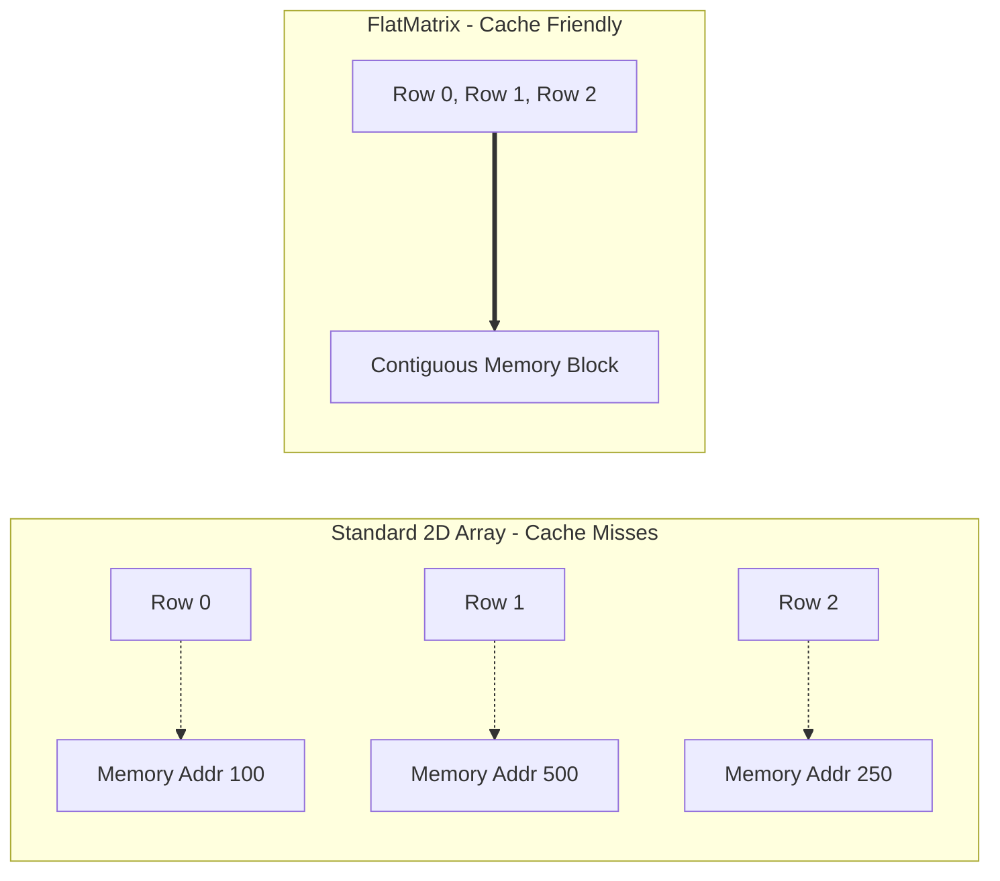
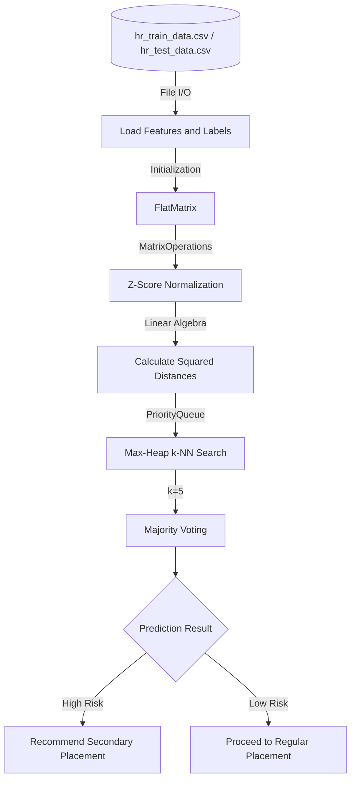

[](https://github.com/TalArbiv31/knn-classifier-matrix-optimization/actions/workflows/ci.yml)
# Cache-Efficient k-NN Classifier (Inspired by HR Data Analytics)

## Overview
During my service as an HR Data Analyst in the IDF, I managed and analyzed hundreds of thousands of personnel records. While SQL and BI tools are excellent for business logic, I realized that Machine Learning algorithms could uncover hidden patterns in placement success rates and dropout risks that standard queries miss.

Inspired by this domain, I built this Java implementation of a **k-Nearest Neighbors (k-NN) classification pipeline from scratch**, coupling it with a highly optimized, cache-efficient memory representation designed to handle large-scale datasets rapidly.

This project bridges practical data analysis experience with core computer science algorithmic design, focusing heavily on runtime efficiency, memory optimization, and hardware-aware programming.

---

## Core Features & Optimizations

### 1. Performance & Memory Optimization (`FlatMatrix`)
When processing massive datasets, standard 2D arrays suffer from cache misses due to fragmented pointer-based memory allocation. 

* **Contiguous Memory Buffers:** Re-implemented standard 2D arrays as contiguous 1D memory buffers in row-major order.
* **Spatial Locality:** Significantly enhances CPU cache utilization, reducing memory access overhead for intensive linear algebra operations and distance calculations.

> ** Benchmark Result:** Running a matrix multiplication test ($800 \times 800$ elements) proves that the contiguous `FlatMatrix` implementation is **~2.5x faster** than standard Java 2D arrays (`double[][]`) purely due to CPU spatial cache locality. *(See `PerformanceBenchmark.java`)*



### 2. Machine Learning Pipeline (k-NN Classifier)
* **Vectorized Distance Computation:** Computes squared distance matrices efficiently across sample batches.
* **Data Normalization:** Features a built-in Z-score normalization mechanism to standardize multi-dimensional features (e.g., psychometric scores vs. physical distances) so no single scale dominates the model.
* **Optimized Neighbor Selection:** Replaced naive array sorting $O(N^2)$ with a Max-Heap (PriorityQueue) structure. This reduces the neighbor search complexity to $O(N \log k)$ per query, rapidly identifying the nearest neighbors for majority voting without losing track of original sample indices.



### 3. Algorithmic Complexity (Big-O)
The system is optimized to eliminate bottlenecks in both the linear algebra and the machine learning operations:
* **Distance Matrix Computation:** $O(N^2 \cdot d)$ time complexity. Avoids naive 3D nested loops by evaluating the algebraic expansion $\Vert{}x - y\Vert{}^2 = \Vert{}x\Vert{}^2 + \Vert{}y\Vert{}^2 - 2\langle x, y \rangle$ using fast matrix multiplication.
* **Space Complexity:** $O(N^2)$ memory footprint. Extracted diagonal broadcasting into 1D arrays to prevent $O(N^3)$ allocations of redundant NxN intermediate matrices.
* **k-NN Inference:** $O(N_{test} \cdot N_{train} \cdot \log k)$ runtime. Bypasses full data sorting by utilizing a Max-Heap size-capped at `k`, maintaining optimal theoretical bounds for large datasets.
---

## Technologies & Principles

* **Language:** Java
* **Core Concepts:** 
  * Cache Locality & Hardware-Aware Design
  * Dynamic 1D-to-2D Index Mapping
  * Matrix Operations & Linear Algebra
  * Priority Queues (Max-Heap) & Lambda Expressions
  * Object-Oriented Design (Clean Interfaces & Polymorphism)

---

## Project Structure

```text
├── src/
│   ├── DemoHRClassifier.java    # End-to-end ML pipeline orchestration
│   ├── FlatMatrix.java          # High-performance 1D array-based matrix implementation
│   ├── Matrix.java              # Core matrix interface
│   ├── MatrixOperations.java    # Linear algebra (normalization, vectorized distances)
│   ├── ModelEvaluator.java      # Statistical metrics and accuracy evaluation
│   └── PerformanceBenchmark.java # CPU cache locality benchmark vs 2D arrays
└── resources/
    ├── hr_train_data.csv        # Historical military placement data
    └── hr_test_data.csv         # New recruits data for inference
```

## Quick Start / How to Run
To execute the complete k-NN machine learning pipeline:
1. Clone the repository.
2. Ensure you have **Java 11+** installed.
3. Run the `DemoHRClassifier` main class. It will automatically load the training and testing CSV datasets from the `resources` directory, execute the model, and print the accuracy metrics to the console.

To run the cache-locality benchmark:
* Execute the `PerformanceBenchmark` class to see the live execution time differences between `FlatMatrix` and standard 2D arrays on your specific CPU architecture.
