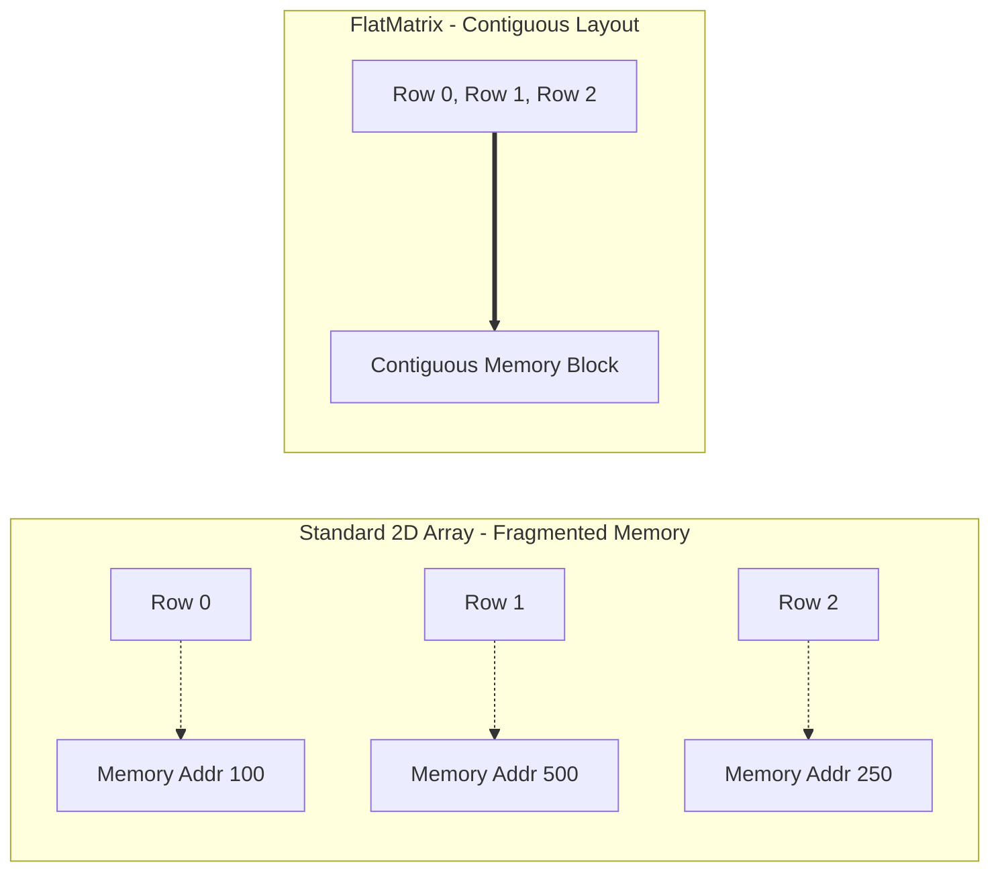
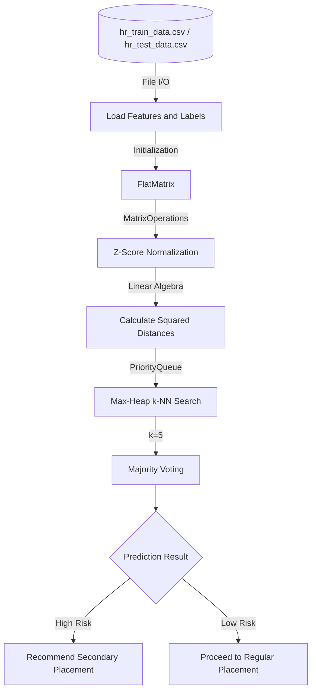

[](https://github.com/TalArbiv31/knn-classifier-matrix-optimization/actions/workflows/ci.yml)
# Cache-Efficient k-NN Classifier (Inspired by IDF Data Analytics)

## Overview
During my service as an Data Analyst in the IDF, I managed and analyzed hundreds of thousands of personnel records. While SQL and BI tools are excellent for business logic, I realized that Machine Learning algorithms could uncover hidden patterns in placement success rates and dropout risks that standard queries miss.

Inspired by this domain, I built this Java implementation of a **k-Nearest Neighbors (k-NN) classification pipeline from scratch**, coupling it with an optimized memory representation designed to handle large-scale datasets.

This project bridges practical data analysis experience with core computer science algorithmic design, focusing on runtime efficiency, memory footprint, and hardware-aware programming concepts.

---

## Core Features & Optimizations

### 1. Performance & Memory Optimization (`FlatMatrix`)
When processing datasets, standard 2D arrays (`double[][]` in Java) suffer from cache misses and Garbage Collector overhead due to fragmented, pointer-based memory allocation (arrays of arrays).

- **Contiguous Memory Buffers:** Re-implemented standard 2D arrays as contiguous 1D memory buffers in row-major order.
- **Hardware-Awareness & JIT Dynamics:** Designed to enhance CPU spatial cache utilization. 

> **Benchmark Results (JIT-Aware):** A dedicated performance benchmark testing matrix multiplication ($1000 \times 1000$ elements) with proper JVM Warm-up phases demonstrates a **consistent 5%-10% speedup** over standard 2D arrays under heavy computational loads. This showcases the mitigation of pointer-chasing overhead and reduced memory fragmentation, even against modern JVM escape analysis and aggressive Garbage Collection optimizations. *(See `PerformanceBenchmark.java`)*



### 2. Machine Learning Pipeline (k-NN Classifier)
- **Vectorized Distance Computation:** Computes squared distance matrices efficiently across sample batches.
- **Data Normalization:** Features a built-in Z-score normalization mechanism to standardize multi-dimensional features (e.g., psychometric scores vs. physical distances) so no single scale dominates the model.
- **Optimized Neighbor Selection:** Replaced naive array sorting $O(N^2)$ with a Max-Heap (PriorityQueue) structure. This reduces the neighbor search complexity to $O(N \log k)$ per query, rapidly identifying the nearest neighbors for majority voting without losing track of original sample indices.



### 3. Algorithmic Complexity (Big-O)

**Time Complexity:**
- **Total End-to-End Runtime:** $\mathcal{O}(N^2 \cdot D + N_{test} \cdot N_{train} \cdot \log k)$
- **Distance Matrix Computation:** $\mathcal{O}(N^2 \cdot D)$. Avoids naive 3D nested loops by evaluating the algebraic expansion $\Vert{}x - y\Vert{}^2 = \Vert{}x\Vert{}^2 + \Vert{}y\Vert{}^2 - 2\langle x, y \rangle$ using fast matrix multiplication.
- **k-NN Inference:** $\mathcal{O}(N_{test} \cdot N_{train} \cdot \log k)$. Bypasses full data sorting by utilizing a Max-Heap size-capped at `k`, maintaining optimal theoretical bounds for large datasets.

**Space Complexity:**
- **Total Memory Footprint:** $\mathcal{O}(N^2)$
- **Optimization:** Extracted diagonal broadcasting into 1D arrays to prevent $\mathcal{O}(N^3)$ allocations of redundant NxN intermediate matrices, ensuring stable execution without overloading the Garbage Collector.
---

## Technologies & Principles

- **Language:** Java 21 / Maven
- **Core Concepts:** 
  * Cache Locality & Hardware-Aware Design
  * JVM Benchmarking (JIT Warm-ups)
  * Dynamic 1D-to-2D Index Mapping
  * Matrix Operations & Linear Algebra
  * Priority Queues (Max-Heap)
  * Continuous Integration (GitHub Actions)

---

## Project Structure

```text
├── .github/workflows/   # CI/CD pipelines (Maven Build & Test)
├── src/
│   ├── main/java/       # Source Code (DemoHRClassifier, FlatMatrix, MatrixOperations, etc.)
│   └── test/java/       # JUnit Test Suites
├── resources/           # Datasets (hr_train_data.csv, hr_test_data.csv)
└── pom.xml              # Maven dependencies and build configuration
```

## Quick Start / How to Run
To execute the complete k-NN machine learning pipeline:
1. Clone the repository via Git: `git clone https://github.com/TalArbiv31/knn-classifier-matrix-optimization.git`
2. Open the project in IntelliJ IDEA (Open as Project -> select `pom.xml`).
3. Run the `DemoHRClassifier` main class. It will automatically load the CSV datasets from the `resources` directory, execute the model, and print the accuracy metrics (~89%) to the console.

To run the cache-locality benchmark:
- Execute the `PerformanceBenchmark` class to observe the execution time differences and JIT warm-up phases between `FlatMatrix` and standard 2D arrays.
